# ⚡ Awesome Real-Time File & Metadata Search 🔍

<div align="center">



<p align="center">
  <a href="https://github.com/ishandutta2007/Awesome-Real-Time-File-Metadata-Search/stargazers"></a>
  <a href="https://github.com/ishandutta2007/Awesome-Real-Time-File-Metadata-Search/network/members"></a>
  <a href="https://github.com/ishandutta2007/Awesome-Real-Time-File-Metadata-Search/blob/main/LICENSE"></a>
  <a href="https://github.com/sindresorhus/awesome"></a>
</p>

**A curated index of top-tier real-time file indexers, low-latency metadata search engines, full-text retrieval frameworks, and enterprise search platforms.**

*Explore sub-second filesystem crawlers, EXIF extractors, AI-agent Model Context Protocol (MCP) servers, and scalable cloud search architectures.*

🌟 **Star this repository if you find it valuable!** 🌟

</div>

---

## 📑 Table of Contents

- [🌐 Sector Overview & Market Dynamics](#-sector-overview--market-dynamics)
- [🟦 SaaS / Hosted Search Platforms](#-saas--hosted-search-platforms)
  - [Enterprise Feature Breakdown](#-enterprise-feature-breakdown)
- [🟩 Open-Source Search Engines & Indexers](#-open-source-search-engines--indexers)
  - [1. junegunn/fzf](#1-junegunnfzf)
  - [2. BurntSushi/ripgrep](#2-burntsushiripgrep)
  - [3. meilisearch/meilisearch](#3-meilisearchmeilisearch)
  - [4. sharkdp/fd](#4-sharkdpfd)
  - [5. typesense/typesense](#5-typesensetypesense)
  - [6. quickwit-oss/tantivy](#6-quickwit-osstantivy)
  - [7. open-metadata/OpenMetadata](#7-open-metadataopenmetadata)
  - [8. quickwit-oss/quickwit](#8-quickwit-ossquickwit)
  - [9. blevesearch/bleve](#9-blevesearchbleve)
  - [10. phiresky/ripgrep-all](#10-phireskyripgrep-all)
  - [11. cboxdoerfer/fsearch](#11-cboxdoerferfsearch)
  - [12. diskoverdata/diskover-community](#12-diskoverdatadiskover-community)
  - [13. sist2app/sist2](#13-sist2appsist2)
  - [14. duxlabs-dev/dux-search](#14-duxlabs-devdux-search)
  - [15. Indosaram/tamsaek](#15-indosaramtamsaek)
  - [16. kimsgent/project-indexly](#16-kimsgentproject-indexly)
  - [17. QingyaoAi/InfoGrep](#17-qingyaoaiinfogrep)
  - [18. drivedex](#18-drivedex)
- [📊 Architectural Comparison Matrix](#-architectural-comparison-matrix)
- [🔎 Real-Time Search Technical Taxonomy](#-real-time-search-technical-taxonomy)
- [🤝 Contributing Guidelines](#-contributing-guidelines)
- [📄 License](#-license)

---

## 🌐 Sector Overview & Market Dynamics

The global enterprise search and metadata management sector represents an estimated market size of **$5.8B to $7.7B**, projected to surpass **$16B by 2032** at an annual growth rate of 9–11%, while metadata management alone commands an additional **$3B to $9B** footprint. The market exhibits a **moderately concentrated yet fragmented structure**: hyperscalers (Microsoft, Google Cloud, AWS) dominate workplace suite bundling, while specialized enterprise AI vendors capture premium RAG and cross-repository retrieval workloads, alongside a vibrant long-tail of open-source projects innovating in local sub-50ms filesystem indexing and Model Context Protocol (MCP) integrations.

---

## 🟦 SaaS / Hosted Search Platforms

The commercial SaaS search ecosystem ranked in descending order by enterprise company size (valuation / annual revenue run-rate):

| Platform | Company Size (Valuation / Revenue) | Starting Tier Pricing | Free Tier / Trial Allowance | Search Modality | Best Use Case |
| :--- | :--- | :--- | :--- | :--- | :--- |
| **[Glean](https://www.glean.com/)** | **$7.2B Valuation** (~$300M ARR) | **~$35 to $65/user/month** (Annual contract min. ~$50k–$60k/yr; 100 seats) | **No self-serve free trial** (Sales-assisted proof of concept / enterprise demo) | Permission-aware federated search & AI assistant | Enterprise cross-SaaS search with identity & ACL compliance |
| **[Algolia](https://www.algolia.com/)** | **$2.3B Valuation** (~$130M+ ARR) | **$0.50 per 1,000 search requests** (Grow Pay-as-you-go plan; $1.75/1k with AI) | **Free forever plan**: 10,000 search requests/month, 100,000 records, 1 app, 10 indices | Hosted API, vector & hybrid search | Customer-facing app & e-commerce search with agentic studio |
| **[Druva inSync](https://www.druva.com/)** | **$2.0B Valuation** (~$200M SaaS ARR) | **$4.00 to $8.00/user/month** (Endpoint & SaaS workload protection tiers) | **30-Day Free Trial** (Full SaaS console access, unlimited trial workloads, no credit card required) | Backup-native federated index & eDiscovery | Enterprise data protection, legal holds & compliance search |
| **[Coveo](https://www.coveo.com/)** | **$294M Market Cap** (~$156M Annual Revenue) | **$600 to $990/month** (Base Tier billed annually; Pro tier from $1,320/mo) | **14-Day Free Trial** (Full platform access, 25+ cloud connectors, 15+ ML models, no credit card required) | Conversational Agentic RAG & enterprise relevance | Managed conversational service search & website catalog discovery |

### 🔍 Enterprise Feature Breakdown

* **[Glean](https://www.glean.com/)**: Connects directly to Google Workspace, Microsoft 365, Slack, Salesforce, Jira, and GitHub. Indexes full metadata and body content while respecting document-level ACL permissions in real time. Delivers conversational generative answers with verified citations and MCP agent connectivity.
* **[Algolia](https://www.algolia.com/)**: Ultra-low-latency distributed hosted search API serving over 1.75 trillion queries annually across global CDNs. Delivers sub-10ms search-as-you-type, typo tolerance, dynamic faceted filtering, vector search, and unified Agent Studio workflows.
* **[Druva inSync](https://www.druva.com/)**: InSync architecture builds a global deduplicated metadata index prior to cloud ingest. Enables real-time eDiscovery searches across thousands of mobile endpoints, laptops, and SaaS mailboxes with forensic custodian tracking.
* **[Coveo](https://www.coveo.com/)**: Combines unified enterprise indexing, semantic query suggestions, behavioral signals, and conversational generative answering through Coveo Atomic UI components and turnkey agentic pipelines.

---

## 🟩 Open-Source Search Engines & Indexers

Open-source real-time search frameworks, filesystem crawlers, and metadata query engines, **ranked in descending order by GitHub star count**:

### 1. [junegunn/fzf](https://github.com/junegunn/fzf)
[](https://github.com/junegunn/fzf/stargazers)  
**Stack:** Go | **License:** MIT | **Latency:** Sub-millisecond  
An interactive Unix command-line fuzzy finder with real-time feedback. While not a background indexing daemon, it streams and matches tens of thousands of file paths, directory metadata, git commits, and shell history lines with instant interactive responsiveness.  
* **Key Capabilities:** Interactive streaming, asynchronous fuzzy matching, preview window for metadata and content, seamless shell integrations.  
* **Ideal For:** CLI power users, shell scripting, and instant interactive file navigation.

### 2. [BurntSushi/ripgrep](https://github.com/BurntSushi/ripgrep)
[](https://github.com/BurntSushi/ripgrep/stargazers)  
**Stack:** Rust | **License:** MIT / Unlicense | **Latency:** Near-instantaneous  
A line-oriented search tool that recursively searches directories for regex patterns while respecting `.gitignore`. Combines Rust's regex engine with multi-threaded directory walking and memory-mapped files to inspect directory structures and file contents faster than GNU grep.  
* **Key Capabilities:** High-performance recursive walker, file-type filtering, unicode & zip search support, ignore rule caching.  
* **Ideal For:** Large source-code trees, automated grep pipelines, and developer search tools.

### 3. [meilisearch/meilisearch](https://github.com/meilisearch/meilisearch)
[](https://github.com/meilisearch/meilisearch/stargazers)  
**Stack:** Rust | **License:** MIT | **Latency:** <50ms  
A lightning-fast, open-source search engine designed for instant search experiences. Features sub-50ms search-as-you-type, typo tolerance, faceted metadata filtering, geosearch, sorting, hybrid semantic search, and out-of-the-box MCP integration for AI agents.  
* **Key Capabilities:** Instant query latency, RESTful API, zero-configuration setup, AI/MCP connectors.  
* **Ideal For:** Application databases, website search bars, e-commerce document search, and local AI agent memory.

### 4. [sharkdp/fd](https://github.com/sharkdp/fd)
[](https://github.com/sharkdp/fd/stargazers)  
**Stack:** Rust | **License:** MIT / Apache-2.0 | **Latency:** Instant  
A simple, fast, and user-friendly alternative to `find`. Executes parallel directory traversal across multiple CPU threads, automatically ignores hidden directories and `.gitignore` patterns, and filters by file extension, size, modification date, and ownership metadata.  
* **Key Capabilities:** Multi-threaded filesystem traversal, regex pattern matching, metadata attribute filtering (time/size/type), colorized terminal output.  
* **Ideal For:** Real-time terminal file discovery, bash automation, and fast filesystem inspection.

### 5. [typesense/typesense](https://github.com/typesense/typesense)
[](https://github.com/typesense/typesense/stargazers)  
**Stack:** C++ | **License:** GPL-3.0 | **Latency:** Sub-50ms  
An open-source, typo-tolerant search engine optimized for sub-50ms search-as-you-type performance. Positioned as an easy-to-operate, memory-efficient alternative to Elasticsearch and an open-source equivalent to Algolia for structured metadata documents.  
* **Key Capabilities:** In-memory index structures, dynamic geo-search, faceted filtering, semantic search, high availability clustering.  
* **Ideal For:** Microservices, SaaS platforms, and digital catalogs requiring instant search without complex JVM overhead.

### 6. [quickwit-oss/tantivy](https://github.com/quickwit-oss/tantivy)
[](https://github.com/quickwit-oss/tantivy/stargazers)  
**Stack:** Rust | **License:** MIT | **Latency:** Sub-millisecond  
A full-text search engine library written in Rust, inspired by Apache Lucene. Tantivy serves as the high-performance search kernel powering modern decentralized and local search engines, delivering fast indexing throughput and low query latency across document metadata fields.  
* **Key Capabilities:** BM25 scoring, fast field indexing, memory-mapped inverted indices, schema-driven metadata fields.  
* **Ideal For:** Engine builders creating embedded search applications and high-throughput log indexers.

### 7. [open-metadata/OpenMetadata](https://github.com/open-metadata/OpenMetadata)
[](https://github.com/open-metadata/OpenMetadata/stargazers)  
**Stack:** Java / Python / TypeScript | **License:** Apache-2.0 | **Latency:** Low-latency API  
The open-standard unified metadata platform and discovery catalog for enterprise data assets, tables, dashboards, and files. Provides real-time metadata indexing, end-to-end data lineage, semantic search, and AI-driven column/attribute classification.  
* **Key Capabilities:** Unified metadata graph, automated ingestion connectors, data quality assertions, real-time search API.  
* **Ideal For:** Data governance teams, active metadata discovery, and enterprise data mesh implementations.

### 8. [quickwit-oss/quickwit](https://github.com/quickwit-oss/quickwit)
[](https://github.com/quickwit-oss/quickwit/stargazers)  
**Stack:** Rust | **License:** AGPL-3.0 | **Latency:** Sub-second on cloud storage  
A sub-second search and analytics engine built on Tantivy designed specifically for logs, traces, and document metadata stored directly on object storage (Amazon S3, MinIO, Azure Blob). Eliminates the need for SSD-attached cluster replicas.  
* **Key Capabilities:** Native object storage decoupled architecture, OpenTelemetry native ingest, cost-efficient petabyte indexing.  
* **Ideal For:** Cloud-scale log analytics, immutable event streams, and massive document metadata archives.

### 9. [blevesearch/bleve](https://github.com/blevesearch/bleve)
[](https://github.com/blevesearch/bleve/stargazers)  
**Stack:** Go | **License:** Apache-2.0 | **Latency:** Millisecond  
A modern text indexing library for Go. Provides document indexing, term queries, phrase queries, boolean queries, fuzzy queries, and numeric/date range queries over custom Go data structures and metadata.  
* **Key Capabilities:** Go-native library, modular storage engines (BoltDB, Badgedb), faceted search, custom analyzers.  
* **Ideal For:** Go microservices, embedded search utilities, and command-line search daemons.

### 10. [phiresky/ripgrep-all](https://github.com/phiresky/ripgrep-all)
[](https://github.com/phiresky/ripgrep-all/stargazers)  
**Stack:** Rust | **License:** AGPL-3.0 | **Latency:** High-throughput streaming  
Extends `ripgrep` to search inside binary and complex file formats: PDFs, docx, epub, zip archives, tarballs, video subtitle streams, and embedded document metadata via converters like `pandoc`, `poppler`, and `ffmpeg`.  
* **Key Capabilities:** Automatic unpacker integration, SQLite-backed caching of extracted text, recursive archive parsing.  
* **Ideal For:** Full-text discovery across heterogeneous office documents and local personal knowledge archives.

### 11. [cboxdoerfer/fsearch](https://github.com/cboxdoerfer/fsearch)
[](https://github.com/cboxdoerfer/fsearch/stargazers)  
**Stack:** C (GTK 3/4) | **License:** GPL-2.0 | **Latency:** Instantaneous  
A standalone, lightning-fast file search utility for Unix and Linux desktops, inspired by Voidtools' *Everything* on Windows. It maintains an in-memory database of filenames and metadata attributes to surface instant search results as you type.  
* **Key Capabilities:** Search-as-you-type GUI, regex and wildcard support, fast incremental index updates, low memory footprint.  
* **Ideal For:** Linux desktop users needing instantaneous desktop file discovery.

### 12. [diskoverdata/diskover-community](https://github.com/diskoverdata/diskover-community)
[](https://github.com/diskoverdata/diskover-community/stargazers)  
**Stack:** Python / PHP / Elasticsearch | **License:** GPL-3.0 | **Latency:** Near-real-time  
An open-source storage analytics, file metadata crawler, and search engine powered by Elasticsearch. Discovers, crawls, and indexes metadata across petabyte-scale NAS, NFS/SMB shares, and cloud storage to uncover cold storage, duplicate files, and storage growth patterns.  
* **Key Capabilities:** Enterprise storage crawling, metadata analytics dashboards, disk utilization heatmaps, tag management.  
* **Ideal For:** Storage administrators, IT operations, and media facilities managing massive multi-terabyte network storage.

### 13. [sist2app/sist2](https://github.com/sist2app/sist2)
[](https://github.com/sist2app/sist2/stargazers)  
**Stack:** C / Elasticsearch / SQLite | **License:** GPL-3.0 | **Latency:** Fast incremental  
A high-performance filesystem indexer and search interface written in C with a Vue.js web UI. Extracts text, thumbnails, and rich EXIF/codec metadata from documents, media, and archives, supporting OCR via Tesseract and recursive parsing inside zip/tar files.  
* **Key Capabilities:** Multi-threaded C crawling, OCR integration, thumbnail generation, disk utilization visualizations.  
* **Ideal For:** Self-hosted file archives, media collections, and local server document repositories.

### 14. [duxlabs-dev/dux-search](https://github.com/duxlabs-dev/dux-search)
[](https://github.com/duxlabs-dev/dux-search/stargazers)  
**Stack:** Go / Bleve | **License:** Apache-2.0 | **Latency:** Real-time watcher  
A fast, configurable filesystem search daemon (invoked via `dsearch`) with built-in EXIF metadata extraction from images. Uses real-time file-system watchers to incrementally update its Bleve index when files are added or modified.  
* **Key Capabilities:** Camera EXIF extraction (ISO, focal length, aperture, GPS bounding boxes), live file-watcher daemon, REST API.  
* **Ideal For:** Photographers, media asset managers, and visual content catalogs.

### 15. [Indosaram/tamsaek](https://github.com/Indosaram/tamsaek)
[](https://github.com/Indosaram/tamsaek/stargazers)  
**Stack:** Rust / Tantivy | **License:** MIT | **Latency:** Sub-second  
A lightweight local file search engine built on Tantivy with full-text indexing, delivered as both a standalone CLI tool and a Model Context Protocol (MCP) server for AI coding agents.  
* **Key Capabilities:** Zero external database dependencies, boolean & regex queries, MCP agent interoperability, extension filtering.  
* **Ideal For:** Developers and AI assistants searching local repositories and document vaults.

### 16. [kimsgent/project-indexly](https://github.com/kimsgent/project-indexly)
[](https://github.com/kimsgent/project-indexly/stargazers)  
**Stack:** Python / SQLite FTS5 | **License:** MIT | **Latency:** Fast local  
A privacy-first, 100% offline local file search tool powered by SQLite FTS5. In addition to metadata extraction across CSV, JSON, Markdown, and images, it provides built-in statistical analysis pipelines and export options.  
* **Key Capabilities:** Zero external telemetry, CSV/NDJSON dataset inspection, tag classification, PDF/Markdown report generation.  
* **Ideal For:** Data analysts and researchers requiring strictly offline local file discovery.

### 17. [QingyaoAi/InfoGrep](https://github.com/QingyaoAi/InfoGrep)
[](https://github.com/QingyaoAi/InfoGrep/stargazers)  
**Stack:** Python | **License:** MIT | **Latency:** Incremental graph  
A hybrid local file search engine and MCP server that constructs a directory and filename metadata relationship graph. Integrates seamlessly with Obsidian vaults for backlink-aware note and document discovery.  
* **Key Capabilities:** Graph-expanded directory search, Obsidian vault parsing, multi-modal query modes, MCP agent tools.  
* **Ideal For:** Knowledge workers, PKM researchers, and AI agents navigating linked notes.

### 18. [drivedex](https://github.com/ishandutta2007)
[](https://github.com/ishandutta2007/Awesome-Real-Time-File-Metadata-Search/stargazers)  
**Stack:** Python (stdlib) | **License:** MIT | **Latency:** Local sync  
A lightweight utility designed to index cloud files (SharePoint Online, OneDrive, Google Drive) into a local encrypted SQLite database for instant offline search and Markdown extraction for LLMs.  
* **Key Capabilities:** Cloud file change logs, DPAPI credential protection, zero external Python dependencies, docx-to-markdown conversion.  
* **Ideal For:** Teams wanting local metadata indexability over Microsoft 365 / Google Workspace documents.

---

## 📊 Architectural Comparison Matrix

| Project / Platform | Type | License | Primary Language | Index Storage | Real-Time Sync Mechanism | Metadata & EXIF Filtering | AI Agent / MCP Support |
| :--- | :--- | :--- | :--- | :--- | :--- | :--- | :--- |
| **Glean** | SaaS | Proprietary | Cloud | Distributed Cloud | Webhooks & Enterprise Polling | Extended ACLs & Permissions | Native Assistant & MCP |
| **Algolia** | SaaS | Proprietary | Cloud | Distributed In-Memory | Real-time REST Ingest API | Custom Attributes & Facets | Agent Studio & MCP |
| **Druva inSync** | SaaS | Proprietary | Cloud | Deduplicated Cloud Index | Endpoint Background Agent | File Attributes & Geo-Location | Legal Hold Integrations |
| **Coveo** | SaaS | Proprietary | Cloud | Cloud Multi-Tenant Index | Enterprise Connectors & Streams | Behavioral & Structural Facets | Search Agent / GenAI |
| **fzf** | OSS | MIT | Go | In-Memory Stream | Interactive Stdin Stream | Path & Modification Times | Shell CLI Integration |
| **ripgrep** | OSS | MIT / Unlicense | Rust | In-Memory Traversal | Real-Time Parallel Walk | Path, Extension, Encoding | CLI / Editor Protocols |
| **Meilisearch** | OSS | MIT | Rust | LMDB / Disk-Backed | Asynchronous Task Queue | Arbitrary JSON Filter Attributes | Native MCP & LangChain |
| **fd** | OSS | MIT / Apache-2.0 | Rust | Real-Time Walk | Multi-Threaded Traversal | Size, Date, Permissions, Type | Terminal Shell Integration |
| **Typesense** | OSS | GPL-3.0 | C++ | In-Memory + Raft Log | Synchronous / Batch Write API | Dynamic Facets & Geo Filtering | REST API / Vector Endpoints |
| **Tantivy** | OSS | MIT | Rust | Inverted Index / Mmap | High-Throughput Batch Commits | Schema-Defined Fast Fields | Library Embedding |
| **OpenMetadata** | OSS | Apache-2.0 | Java / Python | Elasticsearch / OpenSearch | Real-Time Event Bus & CDC | Lineage, Columns, PII, Tags | Semantic & Agent APIs |
| **Quickwit** | OSS | AGPL-3.0 | Rust | Object Storage (S3 / GCS) | Streaming Kafka / OTEL Ingest | Schema & Splitting Keys | OTEL & Tracing Endpoints |
| **Bleve** | OSS | Apache-2.0 | Go | BoltDB / Badgedb | Go Struct Serialization | Structured Field Facets | Go Library Direct Calls |
| **ripgrep-all** | OSS | AGPL-3.0 | Rust | SQLite Extraction Cache | On-The-Fly Binary Decompression | Archive & Embedded Text | CLI Tool |
| **fsearch** | OSS | GPL-2.0 | C | In-Memory Database | Periodic & File Watcher Updates | Size, Date, Type Attributes | Desktop GUI Integration |
| **diskover** | OSS | GPL-3.0 | Python / PHP | Elasticsearch | Scheduled & Parallel Tree Crawl | Extended Metadata, Sizes, Ownership | Web Dashboards & APIs |
| **sist2** | OSS | GPL-3.0 | C | Elasticsearch / SQLite | Multi-Threaded Incremental Scan | EXIF, OCR Text, Video Thumbnails | Web UI & REST Backend |
| **dux-search** | OSS | Apache-2.0 | Go | Bleve | Real-Time Filesystem Watcher | Deep EXIF (ISO, Camera, GPS) | REST API & CLI |
| **tamsaek** | OSS | MIT | Rust | Tantivy | Incremental Directory Indexer | Extension, Source Type, Path | Native MCP Server & CLI |
| **project-indexly** | OSS | MIT | Python | SQLite FTS5 | Local Batch / Incremental Index | CSV / JSON Data Schema & Tags | CLI & Local Export |
| **InfoGrep** | OSS | MIT | Python | Local Vault Graph | File Reindex & Backlink Tracker | Folder Relationship Graph | MCP Server for AI Agents |
| **drivedex** | OSS | MIT | Python | Local Encrypted SQLite | Cloud Delta Polling | Office Formats & Timestamps | Markdown Extraction Pipeline |

---

## 🔎 Real-Time Search Technical Taxonomy

Understanding how different search architectures achieve sub-second latency over large file collections:

```
┌──────────────────────────────────────────────────────────────────────────┐
│                   REAL-TIME METADATA SEARCH ARCHITECTURES                │
└──────────────────────────────────────────────────────────────────────────┘
                                      │
         ┌────────────────────────────┴───────────────────────────┐
         ▼                                                        ▼
┌───────────────────────────────┐              ┌────────────────────────────────┐
│   STREAMING / IN-MEMORY WALK  │              │    PERSISTENT INVERTED INDEX   │
├───────────────────────────────┤              ├────────────────────────────────┤
│ • Zero persistent state on disk│              │ • Asynchronous watcher daemon  │
│ • Multi-threaded dir traversal│              │ • Instant sub-50ms lookup      │
│ • Memory-mapped read buffers  │              │ • Typo tolerance & facets      │
│ • Examples: ripgrep, fd, fzf  │              │ • Examples: Meilisearch, sist2 │
└───────────────────────────────┘              └────────────────────────────────┘
         │                                                        │
         ▼                                                        ▼
┌───────────────────────────────┐              ┌────────────────────────────────┐
│   SPECIALIZED METADATA ENGINE │              │    AI AGENT & MCP ADAPTERS     │
├───────────────────────────────┤              ├────────────────────────────────┤
│ • EXIF extraction (dux-search)│              │ • Folder graph expansion       │
│ • Deep OCR pipelines (sist2)  │              │ • Model Context Protocol tools │
│ • Cloud S3 storage (Quickwit) │              │ • Local AI context pipelines   │
│ • Large storage tree (diskover│              │ • Examples: tamsaek, InfoGrep  │
└───────────────────────────────┘              └────────────────────────────────┘
```

---

## 🤝 Contributing Guidelines

Contributions, improvements, and updates are warmly welcomed! 

1. **Fork the repository** to your GitHub account.
2. **Add the software entry** in alphabetical or star-ranked order with:
   * Project title and verified link.
   * GitHub star count badge (`style=social&color=white`).
   * Primary programming stack and license.
   * Specific description of real-time search, metadata parsing, or indexing capabilities.
3. **Submit a clean pull request** with a concise summary of the addition.

---

## 📄 License

This repository and curated list are distributed under the **Creative Commons CC0 1.0 Universal (Public Domain Dedication)**. Individual indexed software tools retain their respective open-source or commercial proprietary licenses.

<div align="center">
  <sub>Maintained with ❤️ for developers, researchers, and search engineers.</sub>
</div>
